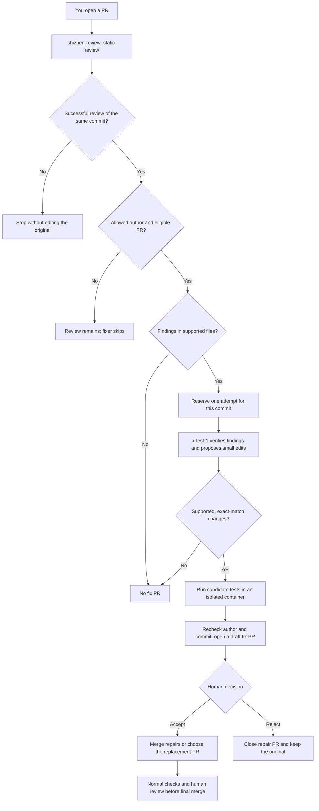

# shizhen-review-fix

**Review → verify the review → propose a repair → test → let a human choose.**

A small GitHub Actions workflow pair that uses an OpenAI-compatible gateway to review pull requests and propose a separate draft repair PR. The included profile uses NUS SoCLaaS `x-test-1`, Java/Gradle, and CS2103T/SE-EDU conventions. It requires no Copilot credits. Gateway access, model quotas, GitHub Actions usage, and repository permissions still apply.

Created by [Shizhen](https://github.com/shiverin), from the idea of keeping the original PR intact while a second agent verifies review findings and prepares an optional repair. Implementation was developed with Codex. This is an experimental, bounded rollout template—not a production reliability claim.

## The workflow



The original PR is never automatically edited, closed, approved, or merged. Failed tests are reported in the draft; they do not become an approval. Infrastructure/model failures stop the run without a fabricated clean result.

## Design choices behind the idea

* **Treat reviews as hypotheses.** A second model pass must verify findings against supplied complete files. This addresses an observed failure in the initial experiment: chunked review flagged a file as missing even though another chunk contained it.
* **Make repairs optional.** Put suggested changes on a separate branch. The author can inspect the diff and discard it without undoing changes to the original PR.
* **Keep humans at the decision point.** Automated checks provide evidence; a draft PR asks the human to decide whether the repair is appropriate.
* **Start with one author.** Use a stable numeric GitHub identity, not a PR label or a comment claiming permission. The initial rollout handles only the configured author's PRs.
* **Bound the automation.** Reserve one attempt per source commit, reject stale reviews, and exclude generated fix branches. Acceptance of a bot repair also stops further automatic repairs on that original PR.
* **Separate powers.** A model can propose text but cannot run commands. Candidate tests receive no keys. Publication happens in a separate job that revalidates the original proposal.

These are design decisions, not claims that this project invented automated code repair. GitHub's [Fix with Copilot](https://docs.github.com/en/copilot/how-tos/use-copilot-agents/use-code-review#using-copilot-code-review) supports related review-to-fix flows. This project makes a bounded variant usable with your own compatible gateway.

## Install in another repository

Prerequisites: GitHub Actions enabled, Python 3.12+, a compatible SoCLaaS key with access to `x-test-1`, a Java/Gradle project matching the included test profile, and permission to open PRs from Actions. Read the [architecture and trust boundaries](docs/architecture.md) before enabling privileged automation.

1. Clone this package and your target repository. Install the templates for **one allowed author**:

   ```bash
   python3 install.py /absolute/path/to/your-repository --author YOUR_GITHUB_LOGIN
   ```

   The installer resolves the numeric ID through `gh api`. For an offline install, provide a verified `--author-id YOUR_NUMERIC_ID`. It refuses to overwrite existing files. It does not commit, push, set secrets, change settings, or install third-party services.

1. Save your SoCLaaS key in the target repository's **Actions secret** named `LLM_API_KEY`, using GitHub's Settings interface. Do not place it in a source file or paste it into a chat. Existing secrets are not replaced by the installer.

1. Review `.github/shizhen-fix/config.json`. It must identify the intended author. The templates fix the gateway to `https://soclaas-api.comp.nus.edu.sg/v1` and the model to `x-test-1`.

1. Review the copied instructions and test profile. This version automatically edits only existing changed Java files under `src/main/java/` and `src/test/java/`, plus `docs/UserGuide.md` and `docs/DeveloperGuide.md`. It does not create new files or edit workflows, dependencies, build scripts, credentials, or arbitrary paths. It cannot reliably repair other languages without adaptation.

1. In **Settings → Actions → General → Workflow permissions**, allow GitHub Actions to create pull requests if your organization permits it. GitHub exposes this together with approval permission; these workflows never submit approvals. Do not assume the setting is already enabled.

1. Open a setup PR, inspect it, and merge the reviewed templates into the target default branch. Both the review handoff and fix workflow must be present there before automatic chaining works. Existing unrelated workflows remain independent.

1. Open a small non-draft PR from the allowed author. First verify the review, handoff artifact, author check, isolated tests, and resulting draft PR. Expand the rollout only after inspecting actual behavior.

### Same-repository branches and forks

| Original PR source | Draft repair destination | Human acceptance |
| --- | --- | --- |
| Branch in the same repository | Original PR's branch | Merge repair PR into the original branch, then review the updated original PR |
| Branch in a fork | Original base branch in the team repository | Replacement PR contains the original changes plus fixes; choose it or keep the original |

A repository `GITHUB_TOKEN` cannot normally update a contributor's fork. The fork path therefore creates a **replacement**, not a hidden edit to the fork. No extra personal access token is required. Do not merge both alternatives independently.

### Manual repair attempt

After a successful `shizhen-review` run with an unexpired handoff:

```bash
gh workflow run shizhen-fix.yml --repo OWNER/REPO -f pr_number=123
```

Manual runs retain the author, stale-head, scope, and one-attempt guards. Rerunning does not bypass a consumed reservation. The reservation is a bot-owned branch named `shizhen-fix/pr-N-SHA`; even a model failure or no-fix response may leave it behind. Inspect the run and branch before deliberately removing a reservation. No automatic retry or cleanup is performed.

### Optional agent skill

The reusable [SKILL.md](skills/shizhen-review-fix/SKILL.md) teaches an assistant how to install and audit this package without widening its permissions. Install that directory through your agent's skill mechanism; it links to this repository for the implementation. The Actions implementation runs independently of the skill.

## Verification and limits

Run package checks locally:

```bash
python3 -m unittest discover -s tests -v
```

Local tests cover author denial, manual-run restrictions, stale-head rejection, exact replacements, path and file-mode restrictions, idempotency, installer conflicts, credential stripping on redirects, and draft publication routing. Actionlint checks the workflow syntax. These checks do not prove gateway authentication, live model behavior, Docker/JDK compatibility on every runner, successful repair quality, or live PR creation. See [validation status](docs/validation.md).

The default reviewer receives diff chunks and limited surrounding context; it can miss cross-file relationships. The fixer receives bounded complete changed files and can still make wrong judgments. It skips repairs requiring unavailable files or new tests. A model finding, a second model agreeing, and passing tests are not independent proof of correctness. Both successful and failed validation produce drafts requiring human review.

The test container has network access for dependency downloads. It has no injected API keys, GitHub tokens, Docker socket, host tools, or shared caches. This is privilege separation, not a guarantee against every container/kernel vulnerability. Docker base images and transitive packages are not fully locked in this experimental profile.

GitHub may suppress or require approval for additional workflows triggered by `GITHUB_TOKEN` writes. The dedicated test job is part of this workflow; do not assume that every existing PR check will automatically run again. Inspect required checks before merging.

## References and license

* [CS2103T review guidance](https://nus-cs2103-ay2627-s1.github.io/website/admin/appendixE-gitHub.html)
* [SE-EDU PR review practices](https://se-education.org/guides/guidelines/PRs-reviewing.html)
* [Google review content](https://google.github.io/eng-practices/review/reviewer/looking-for.html) and [comment style](https://google.github.io/eng-practices/review/reviewer/comments.html)
* [GitHub Actions security](https://docs.github.com/en/actions/reference/security/secure-use)
* [Workflow triggers](https://docs.github.com/en/actions/reference/workflows-and-actions/events-that-trigger-workflows)
* [PR-Agent upstream](https://github.com/qodo-ai/pr-agent)

Original package code is MIT-licensed. See [LICENSE](LICENSE) and [third-party attribution](docs/attribution.md). NUS/SoCLaaS, GitHub, OpenAI, Google, and PR-Agent do not endorse this independent project.
