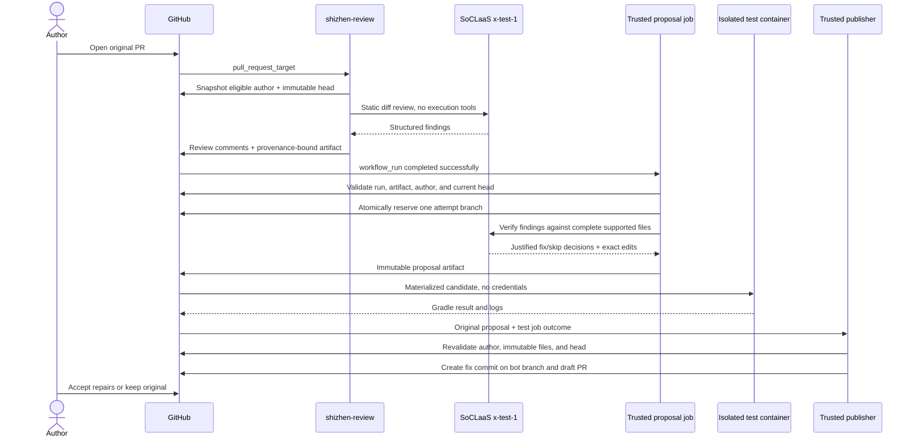

# Architecture

## Jobs and trust boundaries

The `workflow_run` payload does not reliably identify a fork PR. The reviewer therefore exports a narrow authenticated artifact instead of guessing from comments or branch names. The artifact binds repository, PR number, run ID, run attempt, reviewed head SHA, and structured findings. Its only archive member must be `handoff.json`. The fixer checks the successful source workflow's path, name, event, repository, run identity, and attempt-specific artifact name. Artifact sizes and source context are bounded.

Author checks happen before model generation, while preparing the candidate, and again before publishing. The reviewer still reviews other authors; it simply produces no eligible fix handoff for them. Numeric identity prevents a matching display name from expanding the rollout.

## Privileges

| Stage | GitHub permissions | Secrets | Executes PR code? |
| --- | --- | --- | --- |
| Review | Contents read; PR write | Model key | No |
| Propose | Actions read; contents write; PR read | Model key | No; text is API data |
| Materialize/test job | Contents read; PR read | No model key | Only inside the disposable container |
| Publish | Contents write; PR write | Repository token only | No |

The proposal job needs contents write only to atomically reserve a branch. Git data APIs create the eventual files, tree, commit, and bot branch without checking out or executing candidate content in a privileged process. The publisher downloads the generation artifact, not a directory modified by tests. API bearer tokens are stripped when redirects cross hosts.

The container runs as a non-root user with dropped capabilities, no new privileges, a read-only root, bounded CPU/memory/processes, disposable temporary storage, and only candidate source plus a read-only JDK mounted. It has network access for dependencies. Its stdout is evidence for humans, not an authority granting merge permission.

## Stopping conditions

* Other author, draft/closed PR, missing fork, generated fix branch, stale review, or existing accepted fix commit: skip.
* No findings or no supported files: no repair PR.
* Existing reserved attempt: skip without another model request.
* Unsupported/ambiguous paths, symlinks, truncated data, oversized context, invalid model schema, or replacements matching zero/multiple locations: stop.
* No substantiated edits: summarize decisions; no repair PR.
* Failing tests: publish a draft with the failure status, if publication permissions are available.
* Changed original head or modified reservation before publication: stop without overwriting the original branch.

There is a small unavoidable race between the final API check and creation of a draft PR. The draft identifies the exact reviewed SHA, and humans must recheck it if the original advances. Repository administrators can alter trusted default-branch code and settings; this workflow does not defend against a malicious administrator.

## Adapting the profile

The shipped profile is intentionally specific. To support another language, change the allowlist in `fix.py`, update the task and review standards, and replace the isolated validation command and image together. To use another OpenAI-compatible provider, update both workflows and the fix endpoint/model constants, verify request parameters and response format, and test error handling. Never widen supported paths to workflow files just to make automation repair itself.
